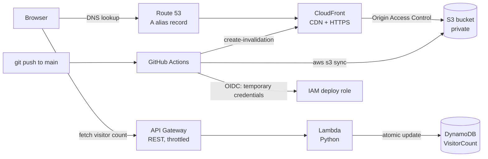

# Cloud Resume Challenge

My personal website and resume, hosted as a serverless site on AWS, with a live visitor counter and automatic deployments from GitHub.

**Live site:** [delhoyo.dev](https://delhoyo.dev)

Built by **Mauricio del Hoyo**, Cloud Technical Consultant at Siemens DISW, Mexico City.

---

## The website

The site has three pages:

| Page | What's on it |
|---|---|
| **Landing** (`index.html`) | Name, title, links to GitHub, LinkedIn, the resume and the featured project, and the live visitor counter. |
| **Resume** (`resume.html`) | Full work history, education, certifications and skills. A print stylesheet turns it into a clean one-page PDF via the browser's **Print / Save as PDF**. |
| **Featured project** (`project.html`) | A short explanation of how this site works, with links to this repository for the details. |

**Design:** a white, minimal layout with a single green accent and small console touches (`$ whoami`, `cd ~`, monospace labels) that nod to Linux and the command line. It uses plain HTML, CSS and JavaScript, with no framework or build step, so the pipeline deploys the files exactly as they are in the repo. The pages adapt to phone screens, and the favicon is a terminal prompt (`>_`).

---

## Architecture

The site runs on three flows: one serves the pages, one powers the visitor counter, and one deploys changes.



**Page load:** Browser → Route 53 → CloudFront → S3 (private bucket)

**Visitor counter:** Page JavaScript → API Gateway → Lambda → DynamoDB

**Deployment:** `git push` → GitHub Actions → S3 sync → CloudFront invalidation

### AWS services

| Service | Role |
|---|---|
| **S3** | Stores the static site files. The bucket is private, and static website hosting is turned off. |
| **CloudFront** | CDN with HTTPS. Reads from S3 through Origin Access Control (OAC). Default root object is `index.html`. |
| **Route 53** | Domain registration and DNS. An A alias record points to CloudFront. |
| **API Gateway** | REST API in front of the Lambda function (non-proxy integration). Handles throttling and CORS. |
| **Lambda** | Python function that increments and returns the visitor count. |
| **DynamoDB** | Stores the visitor count and last-visit timestamp. |
| **IAM** | An OIDC identity provider for GitHub Actions, and a deploy role that only this repository can use. |
| **CloudWatch** | Logs for Lambda and API Gateway. |

---

## Security and cost controls

- **Private S3 bucket.** Block Public Access is on. A bucket policy restricts reads to this CloudFront distribution only, using a `StringEquals` condition on the distribution ARN.
- **HTTPS everywhere** through CloudFront.
- **CORS restricted** to `https://delhoyo.dev`, not `*`. The header is set by API Gateway (an Integration Response header mapping, plus an OPTIONS method for preflight), not by the Lambda code.
- **Rate limiting** on API Gateway: 10 requests/second, burst of 20. There's intentionally no API key, because any key would be visible in the browser's JavaScript.
- **Atomic counter updates.** DynamoDB `update_item` with `ADD` prevents race conditions between simultaneous visitors.
- **Keyless deployments.** GitHub Actions authenticates to AWS with OIDC and gets short-lived credentials. No AWS access keys are stored in GitHub.
- **A tightly scoped deploy role.** Its trust policy only accepts tokens from this repository's `production` GitHub environment, matched on GitHub's immutable owner and repository IDs, and that environment only accepts deployments from `main`. Its permissions only allow listing, writing and deleting objects in the site bucket and invalidating this one CloudFront distribution.
- **Masked deploy settings.** This repository is public, and so are its Actions logs. The role ARN, bucket name and distribution ID are stored as GitHub secrets so they appear as `***` in the logs.
- **Logging.** CloudWatch logs for Lambda and API Gateway. CloudFront access logs go to a dedicated S3 bucket.
- **Cost guardrail.** An AWS Budget alerts at $10/month, managed from the AWS Organizations management account and scoped to the project's member account.

---

## Repository structure

```
.
├── src/
│   ├── frontend/
│   │   ├── index.html                 # Landing page
│   │   ├── resume.html                # Resume page (with print styles)
│   │   ├── project.html               # Featured project page
│   │   ├── main.css                   # Shared styles for all pages
│   │   ├── fetchAPI.js                # Calls the API and updates the counter
│   │   ├── favicon.svg                # Favicon for modern browsers
│   │   ├── favicon.ico                # Favicon fallback for older browsers
│   │   └── apple-touch-icon.png       # Home-screen icon for iOS
│   └── backend/
│       └── incrementVisitorCount.py   # Lambda handler
├── .github/
│   └── workflows/
│       ├── deploy-frontend.yml        # Deploys the frontend to S3 + CloudFront on push to main
│       └── mirror.yml                 # Mirrors this repo to GitLab on every push
└── README.md
```

---

## How the visitor counter works

1. `index.html` loads `fetchAPI.js`.
2. `fetchAPI.js` calls the API Gateway endpoint.
3. API Gateway invokes the Lambda function `incrementVisitorCount.py`.
4. Lambda atomically increments `visitor_count` in DynamoDB, updates `last_visit`, and returns both as JSON.
5. API Gateway returns the response to the browser and adds the CORS header.
6. The script parses the response and writes the count, formatted with thousands separators, into the `#visitor-count` element on the landing page. If the API can't be reached, it shows `—` instead.

The counter only runs on the landing page, so it counts visits to the home page.

---

## Deployment

### Frontend: automatic

The **`deploy-frontend.yml`** workflow runs on every push to `main` that changes `src/frontend/` or the workflow file itself. It can also be started by hand from the Actions tab. It:

1. Gets temporary AWS credentials through **GitHub OIDC** by assuming the deploy role.
2. Syncs `src/frontend/` to the S3 bucket with `aws s3 sync --delete`, so the bucket always matches the repo exactly.
3. Creates a CloudFront invalidation for `/*` so the new files are served right away.

Deploys never overlap: a second push waits for the running deploy to finish.

**Setup, done once:**

1. **IAM identity provider:** an OpenID Connect provider for `https://token.actions.githubusercontent.com`, with audience `sts.amazonaws.com`.
2. **IAM role:** a trust policy that allows `sts:AssumeRoleWithWebIdentity` only when the token's `sub` claim matches this repository's `production` environment (`repo:OWNER@OWNER-ID/REPO@REPO-ID:environment:production`), plus an inline policy with the minimal S3 and CloudFront permissions.
3. **GitHub environment:** `production`, restricted to the `main` branch.
4. **GitHub settings in that environment:** secrets `AWS_ROLE_ARN`, `S3_BUCKET` and `CLOUDFRONT_DISTRIBUTION_ID`, and the variable `AWS_REGION`.

### Backend: manual

The Lambda function is still deployed by hand. Automating it is on the roadmap.

### Mirror

**`mirror.yml`** mirrors every push to a backup repository on GitLab.

---

## Roadmap

- [x] **CI/CD with GitHub Actions.** Sync to S3 and invalidate CloudFront on every push to `main`, authenticated with GitHub OIDC.
- [x] **Site redesign.** Landing page, resume page and featured project page with a shared design and a print-ready resume.
- [ ] **Backend CI/CD.** Run unit tests on the Lambda code and deploy it from the pipeline, then extend the pipeline to run IaC.
- [ ] **Clean URLs.** A CloudFront Function that serves `/resume` and `/project` from `resume.html` and `project.html`.
- [ ] **Spanish version.** Serve `/es/` pages based on the browser's `Accept-Language` header, using a CloudFront Function, with a visible EN / ES switch to override it.
- [ ] **CloudFront custom error pages.** Return a friendly page for 403/404 instead of raw XML.
- [ ] **Infrastructure as Code.** Define all AWS resources in CloudFormation or Terraform, including the API Gateway CORS settings and the OIDC deploy role.
- [ ] **Migrate to an HTTP API with Lambda proxy integration.** Replace the REST API's non-proxy integration with an HTTP API using proxy integration and its native CORS setting. CORS stays in the API configuration, the Lambda returns a standard response, and the frontend can read `data.visitor_count` directly instead of using `JSON.parse(data.body)`. Best done as part of the IaC rebuild.
- [ ] **CloudWatch alarms.** Alert on Lambda errors and API Gateway 5xx spikes via SNS email.
- [ ] **IAM least privilege.** Limit the Lambda role to `dynamodb:GetItem` and `dynamodb:UpdateItem` on the table ARN only.
- [ ] **Cache busting.** Version CSS/JS file names so browsers never use an outdated copy after a deploy.
- [ ] **VPC networking exercise.** EC2 in a VPC with public and private subnets, a NAT gateway and security groups.

---

## Lessons learned

- **Turning off S3 website hosting requires a CloudFront default root object.** Without it, requests to `/` fail. The default root object only applies to `/` itself, which is why the pages link to `resume.html` and `project.html` rather than `/resume`.
- **API Gateway wraps the Lambda response.** The frontend has to `JSON.parse(data.body)` to read the count, otherwise it shows `undefined`.
- **With a non-proxy integration, Lambda can't set HTTP headers.** API Gateway sends the whole object Lambda returns, `headers` included, to the browser as JSON text. I found this when the Lambda code still had my old domain in its CORS header but the site worked fine: the browser's Network tab showed the real header came from API Gateway's Integration Response mapping. I removed the unused header from the Lambda code so the code matches what's deployed, and CORS is now configured in one place.
- **Template literals need backticks.** `` `${count}` `` works, but `'${count}'` prints the text literally.
- **Turn on domain auto-renew.** My original domain expired and was taken by a domain squatter. Moving to `delhoyo.dev` meant a new ACM certificate, new CloudFront alternate domain names, a recreated Route 53 hosted zone and an updated CORS header. The new domain has auto-renew turned on.
- **Throttling has more than one layer.** Under load testing, Lambda's concurrency burst limit was reached before API Gateway's rate limit, which caused 500 errors. This isn't a concern at real traffic levels, but it showed that each service enforces its own limits.
- **GitHub's OIDC subject claim now includes immutable IDs.** My first deploy failed with `Not authorized to perform sts:AssumeRoleWithWebIdentity`. The trust policy expected `repo:mauricio-delhoyo/Cloud-Resume-Challenge:...`, but since mid-2026 new repositories get a `sub` with numeric owner and repository IDs appended (`repo:OWNER@OWNER-ID/REPO@REPO-ID:...`). The IDs never get reused, so a deleted or renamed repo's name can't be claimed by someone else to get a matching token.
- **When AWS says "Not authorized", CloudTrail shows what was actually sent.** The `AssumeRoleWithWebIdentity` event in CloudTrail Event history showed the exact `sub` GitHub sent, which found the problem in one step. The same error also appears for a role ARN with a typo, because AWS doesn't reveal whether a role exists.
- **CloudFront doesn't notice changes in S3.** Each edge location keeps serving its cached copy until it expires, so every deploy needs an invalidation. `/*` counts as a single path, so it stays within the free tier.

---

## About the Cloud Resume Challenge

The [Cloud Resume Challenge](https://cloudresumechallenge.dev/) is a hands-on project created by Forrest Brazeal that covers static hosting, DNS, serverless APIs, databases, IaC and CI/CD.
